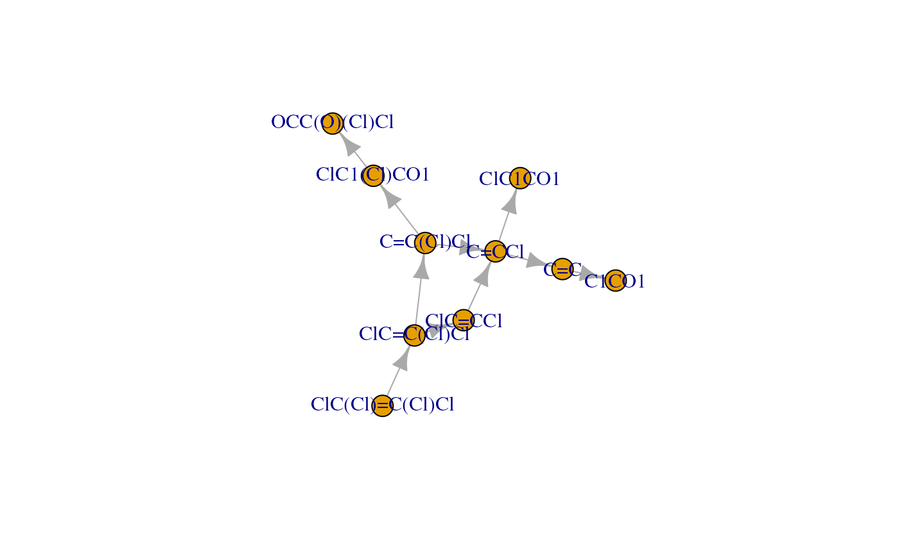
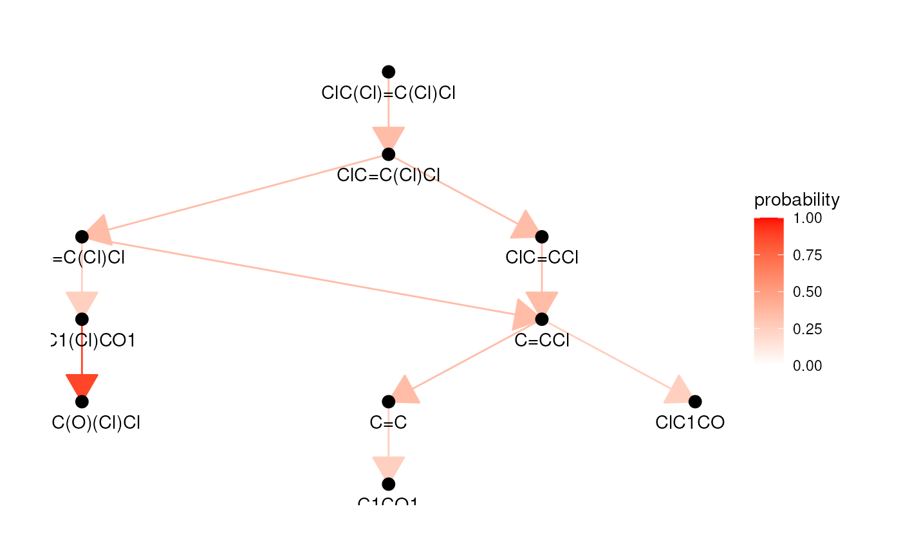

# enviPathR: the R Client for the enviPath RESTful API

## Introduction

enviPath is a biotransformation database and pathway prediction system
focusing on xenobiotic compounds that exacerbate environmental
pollution. Although the enviPath resources are accessible via an
intuitive website, this approach cannot ensure analytical efficiency and
reproducibility. For this, enviPath provides a RESTful API through which
both data retrieval and pathway prediction are possible. The current
package, enviPathR, offers an R client to the enviPath API and thus
brings most of its capabilities to R practitioners studying
environmental pollution and organic contaminant biotransformation.

## Tutorial

This section outlines how to use enviPathR for several different
purposes. If the client interface feels somewhat familiar, that is
because it is inspired by
[KEGGREST](https://bioconductor.org/packages/release/bioc/html/KEGGREST.html),
the R client for the KEGG RESTful API. While enabling all resource
look-up and pathway prediction functionality, the package currently
lacks the API methods for object creation and deletion. That can be
added upon request (external contributions are also welcome).

### Installation

CRAN release version:

\
[`install.packages`](https://rdrr.io/r/utils/install.packages.html)`(``"enviPathR"``)`

Beta version:

\
`remotes``::`[`install_github`](https://remotes.r-lib.org/reference/install_github.html)`(``"enviPath/enviPathR"``)`

Then, we can import enviPathR and another couple of optional packages
used in this tutorial.

\
[`library`](https://rdrr.io/r/base/library.html)`(`[`enviPathR`](https://github.com/enviPath/enviPathR)`)`\
[`library`](https://rdrr.io/r/base/library.html)`(`[`igraph`](https://r.igraph.org/)`)`\
[`library`](https://rdrr.io/r/base/library.html)`(`[`knitr`](https://yihui.org/knitr/)`)`

All the following methods are further described in the enviPathR
[function
reference](https://envipath.github.io/enviPathR/reference/index.html).

### `epTypes`: explore enviPath database structure

enviPath divides its conceptual and biological items into different
object categories, which can be navigated with `epTypes`.

\
`types`` ``<-`` `[`epTypes`](https://envipath.github.io/enviPathR/reference/epTypes.md)`(``)`

The first element of the output contains a vector of object types that
can be listed and explored with `epList`.

\
`# View listable object types`\
[`print`](https://rdrr.io/r/base/print.html)`(``types``$``listable``)`\
`#> [1] "compound" "package"  "pathway"  "reaction" "rule"     "setting"`

The second element is a data frame with the available links between
object types that can be retrieved with `epLink`.

\
`# View linkable object types`\
[`kable`](https://rdrr.io/pkg/knitr/man/kable.html)`(``types``$``linkable``)`

| from     | to        |
|:---------|:----------|
| compound | inchikey  |
| compound | pathway   |
| compound | reaction  |
| compound | smiles    |
| compound | structure |
| pathway  | compound  |
| pathway  | edge      |
| pathway  | node      |
| pathway  | reaction  |
| pathway  | structure |
| reaction | compound  |
| reaction | ec        |
| reaction | pathway   |
| reaction | rhea      |

The graph structure of the database can be visualised by converting the
links to an igraph object.

\
`# Convert edges data frame to igraph object`\
`ep_graph`` ``<-`` `[`graph_from_data_frame`](https://r.igraph.org/reference/graph_from_data_frame.html)`(``types``$``linkable``)`\
\
`# Visualise database graph`\
[`plot`](https://rdrr.io/r/graphics/plot.default.html)`(``ep_graph``)`

### `epLogin`: log into an enviPath personal account

It is necessary to hold an enviPath account to use the API and thus also
enviPathR. A free (for academic use) account can be created at the
[enviPath website](https://envipath.org/). The same login credentials
can then be passed to `epLogin`, which keeps you permanently logged in
unless the cached package cookies are cleared.

\
`# Log into your enviPath account`\
[`epLogin`](https://envipath.github.io/enviPathR/reference/epLogin.md)`(``username``, ``password``)`\
`#> Hi nature lover, welcome to enviPath!`

After logging in once, all remaining methods work right out the box.

### `epList`: retrieve lists of objects from enviPath

The available elements for each object type can be explored using
`epList`.

\
`# List available packages`\
`pkg_df`` ``<-`` `[`epList`](https://envipath.github.io/enviPathR/reference/epList.md)`(``"package"``)`\
\
`# Select reviewed packages`\
`to_keep`` ``<-`` ``pkg_df``$``reviewStatus`` ``==`` ``"reviewed"`\
`pkg_df`` ``<-`` ``pkg_df``[``to_keep``, ``]`\
\
`# Remove lengthy description`\
`pkg_df``$``description`` ``<-`` ``NULL`\
\
`# View list of packages`\
[`kable`](https://rdrr.io/pkg/knitr/man/kable.html)`(``pkg_df``)`

|  | name | id | reviewStatus | Pathways | Rules | Compounds | Reactions | Relative Reasoning | Scenarios |
|:---|:---|:---|:---|---:|---:|---:|---:|---:|---:|
| 3 | EAWAG-SOIL | 5882df9c-dae1-4d80-a40e-db4724271456 | reviewed | 317 | 0 | 2608 | 2445 | 0 | 4881 |
| 6 | EAWAG-SLUDGE | 521c547a-fd2a-491c-ad5b-7eaa1577fb65 | reviewed | 183 | 0 | 1067 | 494 | 0 | 85 |
| 7 | Public Prediction Models | 134886bb-b52e-4ad6-91d3-a02cecde6d95 | reviewed | 0 | 0 | 0 | 0 | 3 | 0 |
| 11 | EAWAG-SEDIMENT | f05e38d8-e9b4-4c3e-b0d8-9ab29966eccf | reviewed | 179 | 0 | 810 | 961 | 0 | 1622 |
| 12 | EAWAG-BBD | 32de3cf4-e3e6-4168-956e-32fa5ddb0ce1 | reviewed | 219 | 499 | 1399 | 1480 | 0 | 1915 |
| 13 | enviPath-PFAS | 87a49584-d937-482c-9c33-25928dcb02a8 | reviewed | 214 | 0 | 590 | 915 | 0 | 288 |

By default, objects are listed from all available packages, but objects
can be listed from a specific package using the argument `pkg`. For
example, it is possible to retrieve pathways only from the EAWAG-BBD
package by providing its unique identifier.

\
`# Select desired package`\
`pkg_name`` ``<-`` ``"EAWAG-BBD"`\
`pkg_id`` ``<-`` ``pkg_df``$``id``[``pkg_df``$``name`` ``==`` ``pkg_name``]`\
\
`# List pathways from desired package`\
`path_df`` ``<-`` `[`epList`](https://envipath.github.io/enviPathR/reference/epList.md)`(``"pathway"``, pkg ``=`` ``pkg_id``)`\
\
`# View list of pathways`\
`path_df`` ``|>`\
`    `[`head`](https://rdrr.io/r/utils/head.html)`(``)`` ``|>`\
`    `[`kable`](https://rdrr.io/pkg/knitr/man/kable.html)`(``)`

| name                    | id                                   | reviewStatus |
|:------------------------|:-------------------------------------|:-------------|
| Uranium                 | 259b990e-d653-4201-9282-04f2c6b05ca0 | reviewed     |
| 2-Aminobenzenesulfonate | 1e7066c2-ff45-44f4-9086-e37db18400df | reviewed     |
| Nicotine                | 1e94c7d7-7f3a-42c7-9dd0-eb1ab217d7ec | reviewed     |
| 2-Aminobenzoate         | dfc8c935-9d73-4067-bfe6-db3501d2075f | reviewed     |
| Caffeine                | 1d537657-298c-496b-9e6f-2bec0cbe0678 | reviewed     |
| Dimethylisophthalate    | a0641e14-3811-482f-a366-cc53f893fce4 | reviewed     |

Similarly, the other supported enviPath object types can also be
explored this way (see `epTypes`).

### `epLink`: map between different types of objects

Links between object types can be retrieved with `epLink`, which takes
the origin and target object types, and optional initial values with the
argument `init`. The latter is recommended to prevent the search from
exploding.

\
`# Define reaction of interest`\
`rxn_id`` ``<-`` ``"2b6bbcc5-77f4-4bed-92a9-731cdc978f6a"`\
\
`# Map desired reaction to related compounds (educts and products)`\
`rxn2cpd`` ``<-`` `[`epLink`](https://envipath.github.io/enviPathR/reference/epLink.md)`(``"reaction"``, ``"compound"``, init ``=`` ``rxn_id``)`\
\
`# View reaction-to-compound mapping`\
[`kable`](https://rdrr.io/pkg/knitr/man/kable.html)`(``rxn2cpd``)`

| reaction                             | compound                             |
|:-------------------------------------|:-------------------------------------|
| 2b6bbcc5-77f4-4bed-92a9-731cdc978f6a | 7281d994-9f4a-4f7f-9e50-90b131c11da3 |
| 2b6bbcc5-77f4-4bed-92a9-731cdc978f6a | befe8eeb-e8f8-4b4a-90b1-d0584a75f8cb |

Multiple initial values can also be used, so that the output represents
a many-to-many mapping.

\
`# Select pathways of interest`\
`path_ids`` ``<-`` ``path_df``$``id``[``1``:``2``]`\
\
`# Map desired pathways to related compounds (nodes)`\
`path2cpd`` ``<-`` `[`epLink`](https://envipath.github.io/enviPathR/reference/epLink.md)`(``"pathway"``, ``"compound"``, init ``=`` ``path_ids``, pkg ``=`` ``pkg_id``)`\
\
`# View pathway-to-compound mapping`\
[`kable`](https://rdrr.io/pkg/knitr/man/kable.html)`(``path2cpd``)`

| pathway                              | compound                             |
|:-------------------------------------|:-------------------------------------|
| 259b990e-d653-4201-9282-04f2c6b05ca0 | d567fc35-a633-4695-ba56-cfe866588989 |
| 259b990e-d653-4201-9282-04f2c6b05ca0 | ddf70678-dae7-4ee3-bd75-a6806d333658 |
| 259b990e-d653-4201-9282-04f2c6b05ca0 | db2b3598-11c1-4b0e-8663-9bc4ebbd5215 |
| 1e7066c2-ff45-44f4-9086-e37db18400df | 9c5c1f6b-8249-426e-a94f-88b678533de0 |
| 1e7066c2-ff45-44f4-9086-e37db18400df | 87a9dcd9-989e-4682-8c3d-176ded170c2d |
| 1e7066c2-ff45-44f4-9086-e37db18400df | 8a806897-4fa6-4c32-a14f-28f81a0f8091 |

Similarly, the other supported enviPath object types can also be linked
this way (see `epTypes`).

### `epGet`: fetch raw objects from enviPath

It may be useful at times to retrieve raw objects to access their
original properties. This is done with `epGet`.

\
`# Fetch reaction object`\
`rxn`` ``<-`` `[`epGet`](https://envipath.github.io/enviPathR/reference/epGet.md)`(``"reaction"``, ``rxn_id``)`\
\
`# View part of reaction data`\
`rxn`` ``|>`\
`    `[`head`](https://rdrr.io/r/utils/head.html)`(``)`` ``|>`\
`    `[`print`](https://rdrr.io/r/base/print.html)`(``)`\
`` #> $`2b6bbcc5-77f4-4bed-92a9-731cdc978f6a` ``\
`` #> $`2b6bbcc5-77f4-4bed-92a9-731cdc978f6a`$aliases ``\
`#> list()`\
`#> `\
`` #> $`2b6bbcc5-77f4-4bed-92a9-731cdc978f6a`$description ``\
`#> [1] "no description"`\
`#> `\
`` #> $`2b6bbcc5-77f4-4bed-92a9-731cdc978f6a`$ecNumbers ``\
`#> list()`\
`#> `\
`` #> $`2b6bbcc5-77f4-4bed-92a9-731cdc978f6a`$educts ``\
`#>             compoundName`\
`#> 1 4-Hydroxybutyraldehyde`\
`#>                                                                                     id`\
`#> 1 https://envipath.org/package_compound_structure/7281d994-9f4a-4f7f-9e50-90b131c11da3`\
`#>      smiles`\
`#> 1 C(CCO)C=O`\
`#> `\
`` #> $`2b6bbcc5-77f4-4bed-92a9-731cdc978f6a`$id ``\
`#> [1] "https://envipath.org/package_reaction/2b6bbcc5-77f4-4bed-92a9-731cdc978f6a"`\
`#> `\
`` #> $`2b6bbcc5-77f4-4bed-92a9-731cdc978f6a`$identifier ``\
`#> [1] "reaction"`\
`#> `\
`` #> $`2b6bbcc5-77f4-4bed-92a9-731cdc978f6a`$medlineRefs ``\
`#> list()`\
`#> `\
`` #> $`2b6bbcc5-77f4-4bed-92a9-731cdc978f6a`$multistep ``\
`#> [1] FALSE`\
`#> `\
`` #> $`2b6bbcc5-77f4-4bed-92a9-731cdc978f6a`$name ``\
`#> [1] "Eawag BBD reaction r0014"`\
`#> `\
`` #> $`2b6bbcc5-77f4-4bed-92a9-731cdc978f6a`$pathways ``\
`#>                                                                          id`\
`#> 1 https://envipath.org/package_pathway/c3d1b8d5-9ffb-49b8-a1bf-bf3d7dfd1ac3`\
`#>              name reviewStatus identifier`\
`#> 1 Tetrahydrofuran     reviewed    pathway`\
`#> `\
`` #> $`2b6bbcc5-77f4-4bed-92a9-731cdc978f6a`$products ``\
`#>         compoundName`\
`#> 1 4-Hydroxybutanoate`\
`#>                                                                                     id`\
`#> 1 https://envipath.org/package_compound_structure/befe8eeb-e8f8-4b4a-90b1-d0584a75f8cb`\
`#>            smiles`\
`#> 1 C(CC(=O)[O-])CO`\
`#> `\
`` #> $`2b6bbcc5-77f4-4bed-92a9-731cdc978f6a`$references ``\
`` #> $`2b6bbcc5-77f4-4bed-92a9-731cdc978f6a`$references$rheaReferences ``\
`#> list()`\
`#> `\
`` #> $`2b6bbcc5-77f4-4bed-92a9-731cdc978f6a`$references$uniprotCount ``\
`#> list()`\
`#> `\
`#> `\
`` #> $`2b6bbcc5-77f4-4bed-92a9-731cdc978f6a`$reviewStatus ``\
`#> [1] "reviewed"`\
`#> `\
`` #> $`2b6bbcc5-77f4-4bed-92a9-731cdc978f6a`$scenarios ``\
`#> list()`\
`#> `\
`` #> $`2b6bbcc5-77f4-4bed-92a9-731cdc978f6a`$smirks ``\
`#> [1] "C(CCO)C=O>>C(CC(=O)[O-])CO"`\
`#> `\
`#> attr(,"call")`\
`#> [1] "https://envipath.org/api/legacy/package/32de3cf4-e3e6-4168-956e-32fa5ddb0ce1/reaction/2b6bbcc5-77f4-4bed-92a9-731cdc978f6a"`

Multiple initial values can also be input to fetch a list of several
different objects.

\
`# Fetch multiple pathways`\
`paths`` ``<-`` `[`epGet`](https://envipath.github.io/enviPathR/reference/epGet.md)`(``"pathway"``, init ``=`` ``path_ids``, pkg ``=`` ``pkg_id``)`\
\
`# View part of pathway data`\
`paths`` ``|>`\
`    `[`lapply`](https://rdrr.io/r/base/lapply.html)`(``head``)`` ``|>`\
`    `[`print`](https://rdrr.io/r/base/print.html)`(``)`\
`` #> $`259b990e-d653-4201-9282-04f2c6b05ca0` ``\
`` #> $`259b990e-d653-4201-9282-04f2c6b05ca0`$aliases ``\
`#> list()`\
`#> `\
`` #> $`259b990e-d653-4201-9282-04f2c6b05ca0`$completed ``\
`#> [1] "true"`\
`#> `\
`` #> $`259b990e-d653-4201-9282-04f2c6b05ca0`$description ``\
`#> [1] "Uranium (U) is the most common radionuclide contaminant at US Department of Energy facilities (Riley et al., DOE/ER-0547T, 1992). More information on this element can be found at the Web Elements U page. The uranyl ion [U(VI)O2]2+ is a common, soluble form of this element in the environment. Microbes can immobilize uranyl ion in several ways, three of which are shown here. The mineral uraninite, U (IV)O2, is highly insoluble. Microbes can reduce uranyl ion to hydrated uraninite. The reduction can be carried out by a cytochrome-c3 hydrogenase from Desulfovibrio vulgaris ([http://www.ncbi.nlm.nih.gov/pubmed/8285665|Lovley et al., 1993]) and other organisms, as shown in the left-most pathway branch. Reaction A, in the middle branch, can be carried out by Deinococcus radiodurans R1 in the laboratory with concomitant oxidation of the humic acid analog anthranhydroquinone-2,6-disulfonate (AQDSH2) to its quinone form ([http://www.ncbi.nlm.nih.gov/pubmed/10788374|Fredrickson et al., 2000]). Humic acid, a brown-colored mixture of polymers, found in lignite, peat, and soils, is assumed to be the environmental cofactor. Uranyl ion can be precipitated as cell-bound hydrogen uranyl phosphate without change in oxidation state of the uranium, as shown in the right-most pathway branch. This reaction is facilitated by acid phosphatase N from Citrobacter sp. N14 ([http://www.ncbi.nlm.nih.gov/pubmed/9763695|Basnakova et al., 1998])."`\
`#> `\
`` #> $`259b990e-d653-4201-9282-04f2c6b05ca0`$id ``\
`#> [1] "https://envipath.org/package_pathway/259b990e-d653-4201-9282-04f2c6b05ca0"`\
`#> `\
`` #> $`259b990e-d653-4201-9282-04f2c6b05ca0`$isIncremental ``\
`#> [1] FALSE`\
`#> `\
`` #> $`259b990e-d653-4201-9282-04f2c6b05ca0`$isPredicted ``\
`#> [1] FALSE`\
`#> `\
`#> `\
`` #> $`1e7066c2-ff45-44f4-9086-e37db18400df` ``\
`` #> $`1e7066c2-ff45-44f4-9086-e37db18400df`$aliases ``\
`#> list()`\
`#> `\
`` #> $`1e7066c2-ff45-44f4-9086-e37db18400df`$completed ``\
`#> [1] "true"`\
`#> `\
`` #> $`1e7066c2-ff45-44f4-9086-e37db18400df`$description ``\
`#> [1] "Many aromatic sulfonates are produced on a multi-ton scale and can be detected in the environment. Hundreds of thousands of kilograms of 2-aminobenzenesulfonic acid are produced for use in the U.S. annually. It is used in organic synthesis and in the manufacture of various dyes and medicines. The initial step in the degradation of 2-aminobenzenesulfonate involves the transport of the compound across the outer membrane of the cell. Alcaligenes sp. O-1 has a selective permeability barrier, allowing three aromatic sulfonates (benzene sulfonate, toluene-4-sulfonate, and 2-aminobenzenesulfonate) to pass through, as described by [http://www.ncbi.nlm.nih.gov/pubmed/8075807|Junker et al. (1994)]. Cell extracts of this species were shown to be capable of degrading at least seven substrates. Deamination of the aromatic ring in strain O-1 has been shown by [http://www.ncbi.nlm.nih.gov/pubmed/8002948|Junker et al. (1994)] to precede desulfurization. Desulfurization of the compound has been shown to precede deamination when degraded by other organisms."`\
`#> `\
`` #> $`1e7066c2-ff45-44f4-9086-e37db18400df`$id ``\
`#> [1] "https://envipath.org/package_pathway/1e7066c2-ff45-44f4-9086-e37db18400df"`\
`#> `\
`` #> $`1e7066c2-ff45-44f4-9086-e37db18400df`$isIncremental ``\
`#> [1] FALSE`\
`#> `\
`` #> $`1e7066c2-ff45-44f4-9086-e37db18400df`$isPredicted ``\
`#> [1] FALSE`

It is also possible to extract specific properties from certain object
types with the argument `property`. These include pathway edges and
nodes and compound structures.

\
`# Extract node property from pathway objects`\
`nodes`` ``<-`` `[`epGet`](https://envipath.github.io/enviPathR/reference/epGet.md)`(``"pathway"``, init ``=`` ``path_ids``, pkg ``=`` ``pkg_id``, property ``=`` ``"node"``)`\
\
`# View nodes`\
[`print`](https://rdrr.io/r/base/print.html)`(``nodes``)`\
`` #> $`259b990e-d653-4201-9282-04f2c6b05ca0` ``\
`` #> $`259b990e-d653-4201-9282-04f2c6b05ca0`$node ``\
`#>                                                                               id`\
`#> 1 https://envipath.org/package_pathway_node/85cfcbd7-1f89-49b9-a3a6-725a54920a01`\
`#> 2 https://envipath.org/package_pathway_node/9838a66c-c9c1-4155-a5cc-5c4705dd817c`\
`#> 3 https://envipath.org/package_pathway_node/739d1209-f196-4038-99df-d92423c94b06`\
`#>                      name reviewStatus identifier`\
`#> 1         3-Sulfocatechol     reviewed       node`\
`#> 2 2-Aminobenzenesulfonate     reviewed       node`\
`#> 3       2-Hydroxymuconate     reviewed       node`\
`#> `\
`#> attr(,"call")`\
`#> [1] "https://envipath.org/api/legacy/package/32de3cf4-e3e6-4168-956e-32fa5ddb0ce1/pathway/259b990e-d653-4201-9282-04f2c6b05ca0/node"`\
`#> `\
`` #> $`1e7066c2-ff45-44f4-9086-e37db18400df` ``\
`` #> $`1e7066c2-ff45-44f4-9086-e37db18400df`$node ``\
`#>                                                                               id`\
`#> 1 https://envipath.org/package_pathway_node/85cfcbd7-1f89-49b9-a3a6-725a54920a01`\
`#> 2 https://envipath.org/package_pathway_node/9838a66c-c9c1-4155-a5cc-5c4705dd817c`\
`#> 3 https://envipath.org/package_pathway_node/739d1209-f196-4038-99df-d92423c94b06`\
`#>                      name reviewStatus identifier`\
`#> 1         3-Sulfocatechol     reviewed       node`\
`#> 2 2-Aminobenzenesulfonate     reviewed       node`\
`#> 3       2-Hydroxymuconate     reviewed       node`\
`#> `\
`#> attr(,"call")`\
`#> [1] "https://envipath.org/api/legacy/package/32de3cf4-e3e6-4168-956e-32fa5ddb0ce1/pathway/1e7066c2-ff45-44f4-9086-e37db18400df/node"`\
`#> `\
`#> attr(,"call")`\
`#> attr(,"call")$url`\
`#> [1] "https://envipath.org/api/legacy/package/32de3cf4-e3e6-4168-956e-32fa5ddb0ce1/pathway/259b990e-d653-4201-9282-04f2c6b05ca0/node"`\
`#> [2] "https://envipath.org/api/legacy/package/32de3cf4-e3e6-4168-956e-32fa5ddb0ce1/pathway/1e7066c2-ff45-44f4-9086-e37db18400df/node"`

### `epModel`: predict compound biotransformation pathways

enviPath provides a set of pre-trained models for chemical fate
prediction and half-life persistence of both known and unknown compounds
given their SMILES representation. The available models can be retrieved
with `epList`.

\
`# List available model settings`\
`set_df`` ``<-`` `[`epList`](https://envipath.github.io/enviPathR/reference/epList.md)`(``"setting"``)`\
\
`# View list`\
[`kable`](https://rdrr.io/pkg/knitr/man/kable.html)`(``set_df``)`

| name | id |
|:---|:---|
| Global Setting - enviFormer | 1d915a48-286a-4394-9693-bfaa187326a5 |
| Global Setting - ECC and App Domain | 3c8e789f-cf5f-4db2-9b77-b152d32e52e9 |
| Global Setting - ECC and App Domain - PEPPER | 3cda8e56-f4ff-47a8-b68c-4cfcfc4e8c2a |
| Global Setting - BBD Rules | a0fbc3d8-ca45-44f1-9c3c-80d8531ffe25 |

Pathway prediction is performed with `epModel`, which uses the
enviFormer model by default. The output list contains two data frames
representing the nodes (compounds) and edges (reactions) of the
predicted pathway, respectively.

\
`# Define smiles of interest`\
`smiles`` ``<-`` ``"ClC(Cl)=C(Cl)Cl"`\
\
`# Perform pathway prediction with enviFormer`\
`former_out`` ``<-`` `[`epModel`](https://envipath.github.io/enviPathR/reference/epModel.md)`(``smiles``)`\
\
`# View compounds in predicted pathway`\
[`kable`](https://rdrr.io/pkg/knitr/man/kable.html)`(``former_out``$``nodes``)`

|  id | name            | depth |
|----:|:----------------|------:|
|   0 | ClC(Cl)=C(Cl)Cl |     0 |
|   1 | O=C(O)C(Cl)Cl   |     1 |

\
\
`# View reactions in predicted pathway`\
[`kable`](https://rdrr.io/pkg/knitr/man/kable.html)`(``former_out``$``edges``)`

| from | to  | probability | multiGenProbability |
|-----:|:----|------------:|--------------------:|
|    0 | 1   |    0.217735 |            0.217735 |

Different model settings can be specified with the argument `setting`.
For example, the PEPPER model can be used which also returns half-lime
estimates for the predicted degradation steps.

\
`# Set id for PEPPER model setting`\
`set_name`` ``<-`` ``"Global Setting - ECC and App Domain - PEPPER"`\
`set_id`` ``<-`` ``set_df``$``id``[``set_df``$``name`` ``==`` ``set_name``]`\
\
`# Perform pathway prediction with PEPPER`\
`pepper_out`` ``<-`` `[`epModel`](https://envipath.github.io/enviPathR/reference/epModel.md)`(``smiles``, ``set_id``)`\
\
`# View compounds in predicted pathway`\
[`kable`](https://rdrr.io/pkg/knitr/man/kable.html)`(``pepper_out``$``nodes``)`

|  id | name            | depth |
|----:|:----------------|------:|
|   0 | ClC(Cl)=C(Cl)Cl |     0 |
|   1 | ClC=C(Cl)Cl     |     1 |
|   2 | C=C(Cl)Cl       |     2 |
|   3 | ClC=CCl         |     2 |
|   4 | C=CCl           |     3 |
|   5 | ClC1(Cl)CO1     |     3 |
|   6 | C=C             |     4 |
|   7 | ClC1CO1         |     4 |
|   8 | OCC(O)(Cl)Cl    |     4 |
|   9 | C1CO1           |     5 |

\
\
`# View reactions in predicted pathway`\
[`kable`](https://rdrr.io/pkg/knitr/man/kable.html)`(``pepper_out``$``edges``)`

| from | to | probability | multiGenProbability | ruleId | ruleName |
|---:|:---|---:|---:|:---|:---|
| 2 | 4 | 0.3414634 | 0.0398137 | af13a678-1d06-402c-ae13-cb00f8830af4 | bt0029 |
| 4 | 6 | 0.3414634 | 0.0135949 | af13a678-1d06-402c-ae13-cb00f8830af4 | bt0029 |
| 4 | 7 | 0.2500000 | 0.0099534 | b7d77873-65b8-4164-9349-b8e7da31dcd6 | bt0049 |
| 5 | 8 | 0.8750000 | 0.0255057 | f628ec30-7088-4c16-a37b-bb4c313236a9 | bt0050 |
| 0 | 1 | 0.3414634 | 0.3414634 | af13a678-1d06-402c-ae13-cb00f8830af4 | bt0029 |
| 3 | 4 | 0.3414634 | 0.0398137 | af13a678-1d06-402c-ae13-cb00f8830af4 | bt0029 |
| 1 | 2 | 0.3414634 | 0.1165973 | af13a678-1d06-402c-ae13-cb00f8830af4 | bt0029 |
| 2 | 5 | 0.2500000 | 0.0291493 | b7d77873-65b8-4164-9349-b8e7da31dcd6 | bt0049 |
| 6 | 9 | 0.2500000 | 0.0033987 | b7d77873-65b8-4164-9349-b8e7da31dcd6 | bt0049 |
| 1 | 3 | 0.3414634 | 0.1165973 | af13a678-1d06-402c-ae13-cb00f8830af4 | bt0029 |

Remarkably, the output of `epModel` can be directly converted to an
igraph object and visualised as a pathway graph. Here, the plot function
from base R is used for simplicity, but the ggraph package is
recommended for more advanced graph visualisation.

\
`# Convert model output to igraph object`\
`path_graph`` ``<-`` `[`graph_from_data_frame`](https://r.igraph.org/reference/graph_from_data_frame.html)`(`\
`    ``pepper_out``$``edges``,`\
`    vertices ``=`` ``pepper_out``$``nodes`\
`)`\
\
`# Visualise predicted pathway`\
[`plot`](https://rdrr.io/r/graphics/plot.default.html)`(``path_graph``)`

As mentioned above, ggraph can be used to create more informative
visualisations including organised layouts and additional aesthetic
layers.

\
[`library`](https://rdrr.io/r/base/library.html)`(`[`ggraph`](https://ggraph.data-imaginist.com)`)`\
\
[`ggraph`](https://ggraph.data-imaginist.com/reference/ggraph.html)`(``path_graph``, layout ``=`` ``"sugiyama"``)`` ``+`\
`    `[`geom_edge_link`](https://ggraph.data-imaginist.com/reference/geom_edge_link.html)`(`[`aes`](https://ggplot2.tidyverse.org/reference/aes.html)`(``colour ``=`` ``probability``)``, arrow ``=`` `[`arrow`](https://rdrr.io/r/grid/arrow.html)`(``type ``=`` ``"closed"``)``)`` ``+`\
`    `[`geom_node_point`](https://ggraph.data-imaginist.com/reference/geom_node_point.html)`(``size ``=`` ``3``)`` ``+`\
`    `[`geom_node_text`](https://ggraph.data-imaginist.com/reference/geom_node_text.html)`(`[`aes`](https://ggplot2.tidyverse.org/reference/aes.html)`(``label ``=`` ``name``)``, vjust ``=`` ``2``)`` ``+`\
`    `[`scale_edge_colour_continuous`](https://ggraph.data-imaginist.com/reference/scale_edge_colour.html)`(``limits ``=`` `[`c`](https://rdrr.io/r/base/c.html)`(``0``, ``1``)``, low ``=`` ``"white"``, high ``=`` ``"red"``)`` ``+`\
`    `[`theme_graph`](https://ggraph.data-imaginist.com/reference/theme_graph.html)`(``base_family ``=`` ``""``)`

### `epLogout`: log out of an enviPath personal account

When finished, for security remember clearing the login cookies with
`epLogout`. If skipped, the next sessions will have access to your
enviPath account without having to call `epLogin`.

\
[`epLogout`](https://envipath.github.io/enviPathR/reference/epLogin.md)`(``)`\
`#> Logged out successfully.`

## Reproducibility

### Cite enviPathR

\
[`citation`](https://rdrr.io/r/utils/citation.html)`(``"enviPathR"``)`\
`#> To cite package 'enviPathR' in publications use:`\
`#> `\
`#>   Hafner J, Lorsbach T, Schmidt S, Brydon L, Dost K, Zhang K, Fenner K,`\
`#>   Wicker J (2024). "Advancements in biotransformation pathway`\
`#>   prediction: enhancements, datasets, and novel functionalities in`\
`#>   enviPath." _Journal of Cheminformatics_, *16*(1), 93.`\
`#>   doi:10.1186/s13321-024-00881-6`\
`#>   <https://doi.org/10.1186/s13321-024-00881-6>.`\
`#> `\
`#> A BibTeX entry for LaTeX users is`\
`#> `\
`#>   @Article{,`\
`#>     title = {Advancements in biotransformation pathway prediction: enhancements, datasets, and novel functionalities in enviPath},`\
`#>     author = {Jasmin Hafner and Tim Lorsbach and Sebastian Schmidt and Liam Brydon and Katharina Dost and Kunyang Zhang and Kathrin Fenner and Jörg Wicker},`\
`#>     journal = {Journal of Cheminformatics},`\
`#>     year = {2024},`\
`#>     volume = {16},`\
`#>     number = {1},`\
`#>     pages = {93},`\
`#>     doi = {10.1186/s13321-024-00881-6},`\
`#>   }`

### Session info

\
[`sessionInfo`](https://rdrr.io/r/utils/sessionInfo.html)`(``)`\
`#> R version 4.6.1 (2026-06-24)`\
`#> Platform: x86_64-pc-linux-gnu`\
`#> Running under: Ubuntu 24.04.5 LTS`\
`#> `\
`#> Matrix products: default`\
`#> BLAS:   /usr/lib/x86_64-linux-gnu/openblas-pthread/libblas.so.3 `\
`#> LAPACK: /usr/lib/x86_64-linux-gnu/openblas-pthread/libopenblasp-r0.3.26.so;  LAPACK version 3.12.0`\
`#> `\
`#> locale:`\
`#>  [1] LC_CTYPE=en_US.UTF-8       LC_NUMERIC=C              `\
`#>  [3] LC_TIME=en_US.UTF-8        LC_COLLATE=en_US.UTF-8    `\
`#>  [5] LC_MONETARY=en_US.UTF-8    LC_MESSAGES=en_US.UTF-8   `\
`#>  [7] LC_PAPER=en_US.UTF-8       LC_NAME=C                 `\
`#>  [9] LC_ADDRESS=C               LC_TELEPHONE=C            `\
`#> [11] LC_MEASUREMENT=en_US.UTF-8 LC_IDENTIFICATION=C       `\
`#> `\
`#> time zone: UTC`\
`#> tzcode source: system (glibc)`\
`#> `\
`#> attached base packages:`\
`#> [1] stats     graphics  grDevices utils     datasets  methods   base     `\
`#> `\
`#> other attached packages:`\
`#> [1] ggraph_2.2.2     ggplot2_4.0.3    knitr_1.52       igraph_2.3.4    `\
`#> [5] enviPathR_1.0.3  httptest2_1.2.2  BiocStyle_2.41.0`\
`#> `\
`#> loaded via a namespace (and not attached):`\
`#>  [1] gtable_0.3.6        xfun_0.62           bslib_0.12.0       `\
`#>  [4] httr2_1.3.0         htmlwidgets_1.6.4   ggrepel_0.9.8      `\
`#>  [7] vctrs_0.7.3         tools_4.6.1         generics_0.1.4     `\
`#> [10] curl_8.1.0          parallel_4.6.1      tibble_3.3.1       `\
`#> [13] pkgconfig_2.0.3     RColorBrewer_1.1-3  S7_0.2.2           `\
`#> [16] desc_1.4.3          lifecycle_1.0.5     compiler_4.6.1     `\
`#> [19] farver_2.1.2        textshaping_1.0.5   brio_1.1.5         `\
`#> [22] ggforce_0.5.0       graphlayouts_1.2.5  codetools_0.2-20   `\
`#> [25] htmltools_0.5.9     sass_0.4.10         yaml_2.3.12        `\
`#> [28] pillar_1.11.1       pkgdown_2.2.1       jquerylib_0.1.4    `\
`#> [31] tidyr_1.3.2         MASS_7.3-66         BiocParallel_1.47.0`\
`#> [34] cachem_1.1.0        viridis_0.6.5       tidyselect_1.2.1   `\
`#> [37] digest_0.6.39       stringi_1.8.9       dplyr_1.2.1        `\
`#> [40] purrr_1.2.2         bookdown_0.48       labeling_0.4.3     `\
`#> [43] polyclip_1.10-7     fastmap_1.2.0       grid_4.6.1         `\
`#> [46] cli_3.6.6           magrittr_2.0.5      tidygraph_1.3.1    `\
`#> [49] withr_3.0.3         scales_1.4.0        rmarkdown_2.32     `\
`#> [52] otel_0.2.0          gridExtra_2.3.1     ragg_1.5.2         `\
`#> [55] memoise_2.0.1       evaluate_1.0.5      testthat_3.3.2     `\
`#> [58] viridisLite_0.4.3   rlang_1.3.0         Rcpp_1.1.2         `\
`#> [61] glue_1.8.1          tweenr_2.0.3        BiocManager_1.30.27`\
`#> [64] jsonlite_2.0.0      R6_2.6.1            systemfonts_1.3.2  `\
`#> [67] fs_2.1.0`
